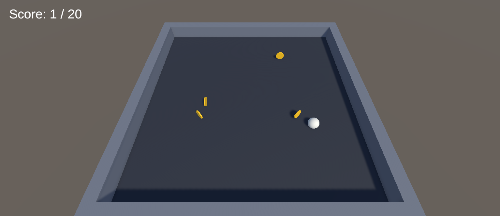
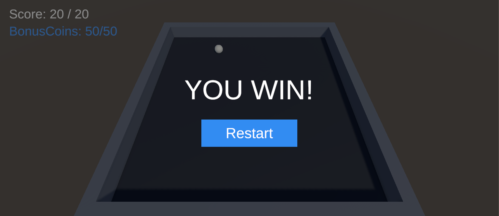
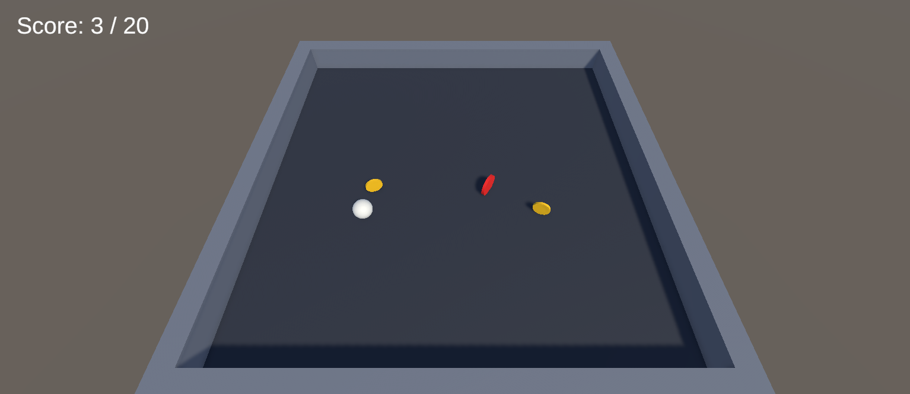
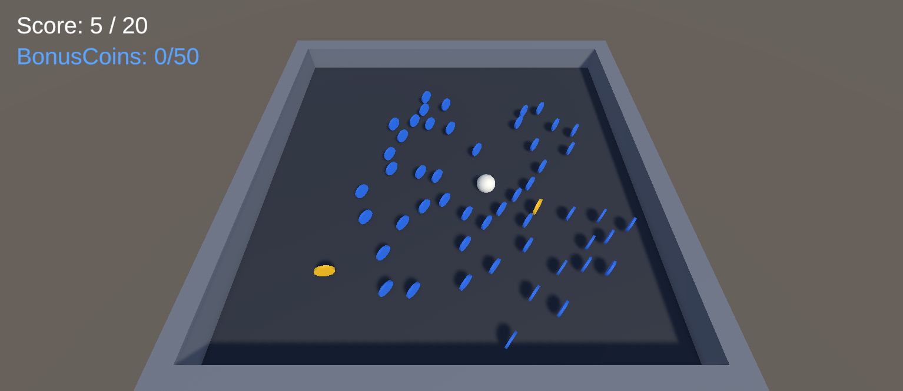

# ITU-CS-464-LAB-05-BSSE23040

Lab 05 for CS-464 Game Development. I made the Roll-a-Ball game from Lecture 06 and then did the three tasks from the lab.

Unity 6000.6.2f1 (URP), C#. Roll number: BSSE23040.

## How to play

Open `Assets/Scenes/Game.unity` and press Play. Move the ball with `W A S D` or the arrow keys and collect the gold coins. A new coin appears every 1.5 seconds and there are never more than 5 at once. When the score reaches 20 the game shows "YOU WIN!" and a Restart button.

| Playing | Win screen |
|---|---|
|  |  |

## Scripts

- `PlayerController`: reads the keys in `Update` and pushes the ball with `AddForce` in `FixedUpdate`.
- `Coin`: has a trigger collider. When the ball touches it, it tells the `GameManager` and destroys itself.
- `Spawner`: spawns the coins at random places and counts its children to stop at 5.
- `GameManager`: keeps the score, updates the text, shows the win panel and restarts the scene.

## The three tasks

**1. One red coin at a random score from 1 to 10.**
When the game starts, `GameManager` picks a random number from 1 to 10. The first time the score reaches it, the `Spawner` creates one red coin. A bool (`redCoinSpawned`) stops it from spawning again. The red coin is not a child of the spawner, so it does not take one of the 5 coin places.



**2. 50 blue coins around the player.**
When the red coin is collected, the `Spawner` creates exactly 50 blue coins in a ring around the ball, between 1.5 m and 8 m away. I take the square root of a random squared distance so the coins spread evenly and do not pile up in the middle. Coins stay a little apart from each other and inside the walls.

**3. Hidden BonusCoins text.**
The text is in the scene but switched off. When the red coin is collected it turns on and shows `BonusCoins: 0/50`. Each blue coin you collect adds 1.



## Things I decided

- The win score is 20 and not 10. The red coin can show up as late as score 10, so with 10 you could win before you ever see it.
- The red coin gives +1 score like a normal coin. Blue coins do not change the score, only the BonusCoins text.
- The task did not say exactly when the BonusCoins text should appear. I show it as soon as the red coin is collected. To show it only after the first blue coin, move the `bonusText.gameObject.SetActive(true)` line from `CollectRedCoin` to `CollectBonusCoin` in `GameManager`.
- Restart resets the score, the bonus text and all coins.

## Folders

```
Assets/Scripts     PlayerController, Coin, Spawner, GameManager
Assets/Prefabs     Coin, RedCoin, BlueCoin
Assets/Materials   floor, walls, ball and coin colours
Assets/Scenes      Game.unity
Docs/screenshots   pictures used in this README
```

## Git

I worked on the `development` branch with small commits and merged it into `main` with a pull request.
